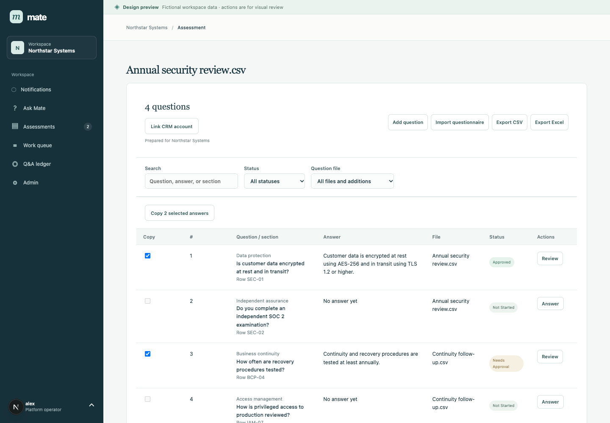

# Questionnaire review demo

A standalone example of a workflow from Mate: retrieve supporting policy text, attach a citation, and require a human decision before export. Unsupported or ambiguous answers stay blocked until a reviewer resolves the evidence.

Run with Python 3.10 or later:

```sh
python3 review.py
python3 -m unittest -v
```

The demo uses a fictional policy and deterministic keyword matching. It illustrates the review boundary without requiring an LLM, API key, customer data, or access to Mate's production code.

## Application context



This is the Mate application that inspired this standalone example. The screenshot uses synthetic preview data.
